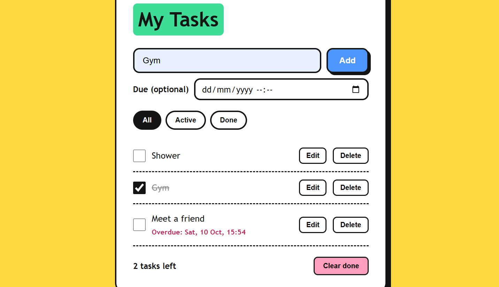

# Task Manager

A simple to-do app where you can add, edit, tick, delete and filter tasks, with optional due dates. Tasks are saved in the browser, so they are still there after a refresh.

**Live demo:** ADD YOUR LINK LATER

## Features

- Add, edit, tick and delete tasks
- Filter by All, Active and Done
- Optional due date and time, with a red "Overdue" label
- Clear all finished tasks in one click
- Saved in the browser with localStorage
- Works with a keyboard and on small phone screens

## Built with

HTML, CSS and plain JavaScript (no libraries).

## What I learned

- Keeping one source of truth (the `tasks` list) and redrawing the page from it
- Saving data with localStorage, and handling errors with try/catch
- Working with dates in JavaScript
- Building a layout that works from 320px up
- Showing user text safely with `textContent`

## What I would improve

- Sort tasks by due date
- Let the edit box change the due time too
- Add an undo button after deleting